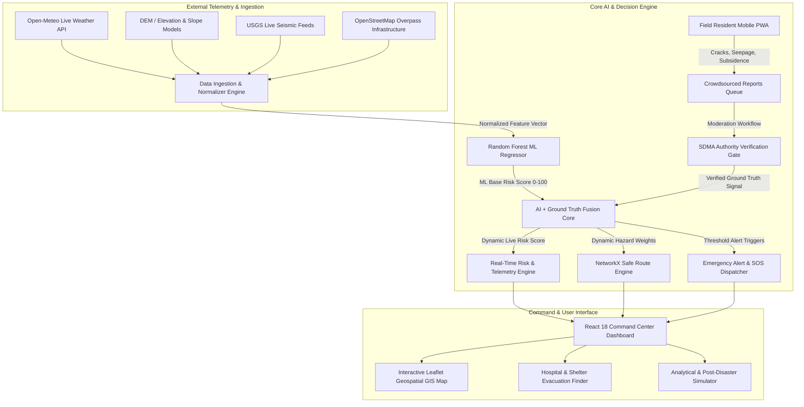

# LANDSLIDEGUARD 🏔️🛡️
### AI-Assisted Landslide Early Warning, Risk-Weighted Safe Routing & Community Ground Truth Fusion Platform

**Smart India Hackathon 2026 Prototype**  
**Problem Statement ID:** SIH26001  
**Region:** North Eastern Region (NER), India & Global Location Intelligence  
**Theme:** Disaster Management  
**Tagline:** *“Predict Risk. Navigate Safely. Protect Communities.”*

---

## 📌 Executive Summary & Innovation

Landslides in mountainous terrains—such as India's North Eastern Himalayan Region (Meghalaya, Sikkim, Nagaland, Mizoram, Assam, Arunachal Pradesh)—cause recurring loss of lives, severed highway lifelines (e.g., NH-6, NH-10, NH-29), stranded supply chains, and localized economic blockades. Traditional early-warning systems often operate in isolated silos: satellite forecasts lack hyper-local ground verification, static danger maps do not provide actionable evacuation paths, and emergency responders lack a unified, verified field intelligence stream.

**LANDSLIDEGUARD** addresses these critical gaps with a unified, closed-loop triad:

$$\text{PREDICT} \longrightarrow \text{ROUTE} \longrightarrow \text{VERIFY}$$

### Core Innovations
1. **AI-Driven Geophysical Risk Prediction:** Real-time Random Forest Regression modeling multi-variable geophysical and meteorological inputs ($24\text{h}/72\text{h}$ precipitation, slope gradient, soil moisture, NDVI, historical slide recurrence).
2. **Explainable AI (XAI) Factor Attribution:** Transparent, natural-language explanation breakdowns and dynamic feature importance charts, enabling disaster managers and juries to understand *why* an alert triggered.
3. **Hazard-Weighted Safe Route Engine:** NetworkX graph-theoretic routing engine with non-linear hazard cost penalties, automatically plotting safe detour corridors that avoid active slide zones and vulnerable escarpments.
4. **AI + Human Ground Truth Fusion Core:** Mobile-first crowdsourced field reporting with an administrative verification gate. Verified observations dynamically escalate live risk scores ($+15.0$ risk boost for $\ge 3$ verified reports) in real time.
5. **Real-Time Global & Regional Telemetry:** Live meteorological feeds (Open-Meteo WMO weather), digital elevation models (DEM), USGS seismic trigger monitoring, and OpenStreetMap (OSM) infrastructure indexing.
6. **Multi-Tier Role-Based Access Control (RBAC):** Granular permission boundaries for Residents, District Authorities (SDMA), and National Administrators (NDMA).

---

## 🏗️ System Architecture & Technology Stack



### Technology Stack

| Layer | Technologies | Key Capabilities |
| :--- | :--- | :--- |
| **Frontend UI/UX** | React 18, Vite, Tailwind CSS, Vanilla CSS Design System | Responsive PWA layout, Glassmorphic HUD, Dark/Light modes, Dynamic Atmospheric Weather Canvas |
| **Mapping & GIS** | Leaflet, React-Leaflet, GeoJSON, OSM Tiles | Interactive hazard polygons, waypoint routing layers, shelter clustering, live GPS tracking |
| **Backend API** | Python 3.11+, FastAPI, Uvicorn, Pydantic v2 | High-throughput asynchronous REST API, Thread-safe memory store, Modular router hierarchy |
| **Machine Learning & Graph** | Scikit-Learn, NetworkX, Pandas, NumPy, Joblib | Random Forest Risk Model ($R^2 > 0.93$), Dijkstra shortest vs. hazard-weighted safe pathing |
| **Security & Auth** | JWT (JSON Web Tokens), PBKDF2/Argon2 hashing | Strict RBAC middleware decorators, stateless token authentication, sanitized input parsing |

---

## 👥 Demo User Accounts (RBAC)

The platform comes pre-configured with role-based operational tiers:

| Role | Email | Password | Permissions & Capabilities |
| :--- | :--- | :--- | :--- |
| **District Authority (SDMA)** | `officer@sdim.ner.gov.in` | `authority123` | Inspect field reports, verify/reject community submissions, trigger dynamic fusion risk updates, dispatch emergency response teams |
| **National Admin (NDMA)** | `admin@ndma.gov.in` | `admin123` | Full administrative control, system telemetry reset, global model tuning, master analytics, user role delegation |
| **Field Resident** | `resident@landslideguard.gov.in` | `resident123` | View live hazard maps, calculate evacuation routes, submit geolocated ground truth reports, access SOS & shelter directory |

---

## 🔬 Explainable AI & Machine Learning Pipeline

### Machine Learning Architecture
* **Algorithm:** Random Forest Regressor (ensemble of $100$ decision trees with bootstrap aggregation).
* **Pipeline Artifacts:**
  * Model Training Script: [`backend/app/ml/train_model.py`](file:///d:/Visual%20Studio%20Code/Demo2/backend/app/ml/train_model.py)
  * Serialized Model: [`backend/app/ml/model.joblib`](file:///d:/Visual%20Studio%20Code/Demo2/backend/app/ml/model.joblib)
  * Feature Metadata: [`backend/app/ml/feature_metadata.json`](file:///d:/Visual%20Studio%20Code/Demo2/backend/app/ml/feature_metadata.json)
  * Inference & XAI Engine: [`backend/app/ml/predictor.py`](file:///d:/Visual%20Studio%20Code/Demo2/backend/app/ml/predictor.py)

### Feature Contribution Breakdown & Geophysical Rationale
1. **Slope Gradient ($\approx 69\%$ Weight):** Primary mechanical driving force. Slopes $> 30^\circ$ exhibit exponentially elevated gravitational shear stress.
2. **72h Cumulative Antecedent Precipitation ($\approx 15\%$ Weight):** Subsurface saturation indicator driving pore-water pressure and shear strength reduction.
3. **24h Flash Rainfall Intensity ($\approx 9\%$ Weight):** Trigger for rapid topsoil liquefaction and shallow debris flows.
4. **Soil Moisture & NDVI ($\approx 7\%$ Weight):** Clay/silt saturation levels vs. root-binding vegetation defense index.

### AI + Community Ground Truth Fusion Formula
When field reports are verified by authorized SDMA personnel, the dynamic risk score formula fuses the algorithmic ML baseline with ground truth:

$$\text{Final Risk Score} = \min\left(100.0, \; \text{ML\_Base\_Score} + \min\left(20.0, \; N_{\text{verified}} \times 5.0\right)\right)$$

* For $\ge 3$ verified ground reports: $+15.0$ risk score escalation.
* For $\ge 4$ verified ground reports: $+20.0$ maximum ground truth risk escalation.

---

## 🚗 Risk-Weighted Safe Routing Engine

Standard navigation algorithms optimize purely for Euclidean distance or travel time, frequently funneling civilian vehicles directly into active slide paths. **LANDSLIDEGUARD** implements risk-weighted routing via NetworkX:

$$\text{Edge Cost} = \text{Length (km)} \times \left(1.0 + \alpha \times \left(\frac{\text{Zone Risk Score}}{100}\right)^\beta\right)$$

* $\alpha = 4.0$ (Hazard avoidance multiplier)
* $\beta = 2.0$ (Non-linear hazard penalty exponent)

This guarantees that when a highway segment crosses a High ($\ge 60$) or Critical ($\ge 80$) risk sector, the routing algorithm automatically identifies and benchmarks a safe detour corridor.

---

## 🔒 Security & Data Integrity

1. **Role-Based API Guardrails:** All administrative and moderation endpoints enforce JWT-validated claims (`role: authority` or `role: admin`). Unauthorized calls return HTTP 403 Forbidden.
2. **Thread-Safe State Synchronization:** Multi-threaded backend state management guarantees atomic updates during concurrent telemetry reads, report submissions, and verification events.
3. **Zero Secret Hardcoding:** Authentication tokens and environment configurations utilize environment overrides with secure fallbacks.
4. **Offline Resilience & Data Integrity:** The frontend incorporates an offline queue (`offlineQueue.js`) that caches resident reports during field network blackouts and synchronizes them upon reconnection.

---

## 📡 API Reference Overview

| Domain | Method | Endpoint | Description |
| :--- | :--- | :--- | :--- |
| **Health** | `GET` | `/api/health` | Service health, ML model readiness, active zone summary |
| **Prediction** | `POST`| `/api/predict` | Run Random Forest prediction on custom feature vectors |
| **Telemetry** | `POST`| `/api/telemetry/inspect` | Resolve live global weather, DEM elevation, and seismic triggers |
| **Risk Zones** | `GET` | `/api/risk-zones` | List monitored risk zones with live fused risk scores |
| **Risk Zones** | `GET` | `/api/risk-zones/{zone_id}` | Detailed zone telemetry, XAI explanations, and local history |
| **Routing** | `GET` | `/api/safe-route/waypoints` | Fetch road graph nodes, junctions, and regional transit hubs |
| **Routing** | `POST`| `/api/safe-route` | Calculate Fastest Route vs. AI Safe Route comparison |
| **Reports** | `GET` | `/api/reports` | List community ground reports (filterable by status/zone) |
| **Reports** | `POST`| `/api/reports` | Submit geolocated citizen observation |
| **Moderation** | `PATCH`| `/api/reports/{id}/verify` | Authority verification/rejection triggering dynamic fusion |
| **Alerts** | `GET` | `/api/alerts` | Active disaster warnings, advisory bulletins, and evacuations |
| **Analytics** | `GET` | `/api/analytics` | Risk distributions, feature importance, and historical timelines |
| **SOS** | `POST`| `/api/sos/broadcast` | Broadcast emergency SOS distress signal with GPS coordinates |
| **Auth** | `POST`| `/api/auth/login` | Authenticate user credentials and return JWT bearer token |

---

## 🚀 Quickstart & Setup Instructions

### Prerequisites
* Python 3.10+
* Node.js 18+ and npm

### 1. Launch FastAPI Backend
```bash
# Navigate to backend directory
cd backend

# Install dependencies
pip install -r requirements.txt

# Start FastAPI application
python run_server.py
```
* **API Service:** `http://localhost:8000`  
* **Interactive Swagger UI:** `http://localhost:8000/docs`

### 2. Launch React Frontend
```bash
# In a new terminal, navigate to frontend directory
cd frontend

# Install npm packages
npm install

# Start Vite development server
npm run dev
```
* **Web Application:** `http://localhost:5173`

---

## 🎬 Step-by-Step Demonstration Flow (SIH 2026)

1. **Landing Page (`/`):**
   - Present problem statement **SIH26001** and region focus (North Eastern Himalayan Region).
   - Review the closed-loop **PREDICT $\rightarrow$ ROUTE $\rightarrow$ VERIFY** architecture.
2. **Overview Command Center (`/overview`):**
   - Inspect summary KPIs: *Regional Risk Index, Critical Sectors, Verified Reports, Active Alerts*.
   - View the color-coded GIS map and telemetry feed for monitored sectors (e.g., `NER-042: Nongpoh - Umsning`).
3. **Risk Map & Explainable AI (`/risk-map`):**
   - Select a high-hazard sector and open the **Zone Telemetry Drawer**.
   - Review real-time sensor metrics (Rainfall, Slope, Soil Moisture, NDVI) and the **XAI Factor Attribution breakdown**.
4. **Safe Evacuation Routing (`/safe-route`):**
   - Set **Origin:** `Guwahati Khanapara Hub` $\rightarrow$ **Destination:** `Shillong City Center`.
   - Click **"CALCULATE SAFE ROUTE"** to compare the direct hazardous corridor against the AI Safe Route detour.
5. **Citizen Ground Truth Submission (`/community-reports`):**
   - Submit a new observation (*Tension cracks observed, subsurface displacement*).
   - Show that the submission enters the **PENDING** moderation queue.
6. **Authority Verification & Real-Time Dynamic Fusion:**
   - Log in as **District Authority** (`officer@sdim.ner.gov.in` / `authority123`).
   - Navigate to the **Moderation Tab** and approve the report with field notes.
   - Observe the live notification confirming **AI + Ground Truth Fusion Activated** and verify the live score increase on the Risk Map.
7. **SOS Emergency & Evacuation Resources (`/sos`, `/hospitals-shelters`):**
   - Demonstrate one-click emergency broadcast and nearest medical/shelter facility lookup.
