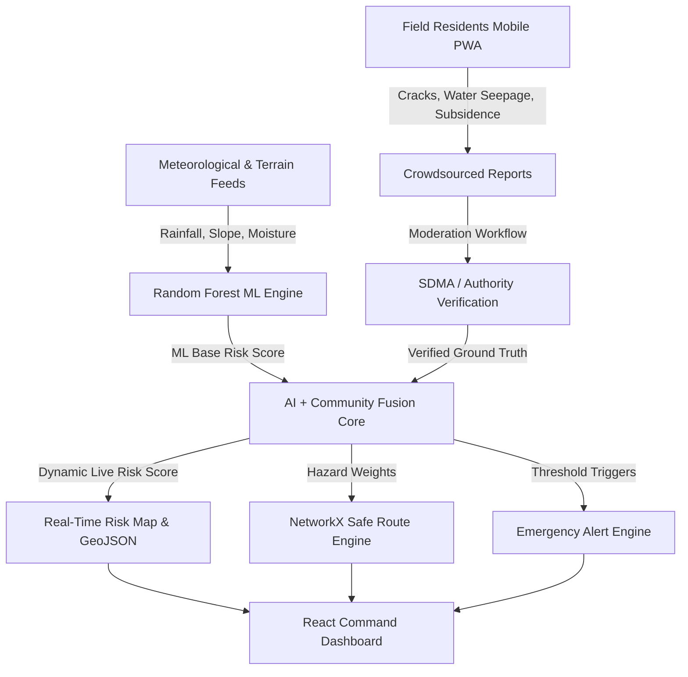

# LANDSLIDEGUARD 🏔️🛡️
### AI-Assisted Landslide Early Warning, Risk-Weighted Safe Routing & Community Ground Truth Fusion Platform
**Smart India Hackathon 2026 Prototype**  
**Problem Statement ID:** SIH26001  
**Region:** North Eastern Region (NER), India  
**Theme:** Disaster Management  
**Tagline:** *“Predict Risk. Navigate Safely. Protect Communities.”*

---

## 📌 Executive Summary & Innovation

Landslides in the North Eastern Himalayan region (Meghalaya, Sikkim, Nagaland, Mizoram, Assam, Arunachal Pradesh) cause recurring loss of lives, severed highway arteries (e.g. NH-6, NH-10, NH-29), and economic blockades. 

**LANDSLIDEGUARD** is a next-generation decision support platform built upon a closed-loop triad:

$$\text{PREDICT} \longrightarrow \text{ROUTE} \longrightarrow \text{VERIFY}$$

1. **AI-Based Landslide Risk Prediction:** Random Forest Regression modeling geophysical and meteorological triggers (24h/72h rainfall, slope gradient, soil moisture, NDVI, historical frequency).
2. **Explainable AI (XAI):** Natural language factor attribution and dynamic feature importance charts ready for jury and emergency officer evaluation.
3. **Risk-Aware Safe Route Engine:** NetworkX graph-theoretic routing applying non-linear hazard cost penalties to divert evacuation convoys around active slide zones.
4. **AI + Human Ground Truth Fusion:** Mobile-first crowdsourced field reporting with an administrative verification gate where verified observations directly update live risk scores (+15 boost for $\ge 3$ verified reports).
5. **Multi-Tier Role-Based Access Control (RBAC):** Distinct permissions for Residents, District Authorities (SDMA), and National Administrators (NDMA).

---

## 🏗️ System Architecture & Technology Stack



### Technology Stack
- **Frontend:** React 18, Vite, Tailwind CSS, Leaflet, React-Leaflet, Lucide Icons, Axios, React Router.
- **Backend:** Python 3.11+, FastAPI, Pydantic v2, Uvicorn, NetworkX, Scikit-Learn, Pandas, NumPy, Joblib.
- **Data & Geospatial:** GeoJSON polygons for 12+ NER risk zones, OpenStreetMap road graph, In-memory thread-safe state store (PostgreSQL/Supabase ready).

---

## 🚀 Quickstart & Setup Instructions

### Prerequisites
- Python 3.10+
- Node.js 18+ and npm

### 1. Start the FastAPI Backend
```bash
# From repository root
cd backend
pip install -r requirements.txt
python run_server.py
```
*Backend runs on:* `http://localhost:8000`  
*Swagger Documentation:* `http://localhost:8000/docs`

### 2. Start the React Frontend
```bash
# In a new terminal from repository root
cd frontend
npm install
npm run dev
```
*Frontend runs on:* `http://localhost:5173`

---

## 👥 Demo User Accounts (RBAC)

The application comes pre-loaded with realistic accounts representing different operational levels:

| Role | Email | Password | Permissions |
| :--- | :--- | :--- | :--- |
| **District Authority (SDMA)** | `officer@sdim.ner.gov.in` | `authority123` | Inspect field reports, verify/reject submissions, trigger fusion updates, view command center |
| **National Admin (NDMA)** | `admin@ndma.gov.in` | `admin123` | Full access, analytics, user management, system reset |
| **Field Resident** | `resident@landslideguard.gov.in` | `resident123` | View risk map, calculate safe routes, submit mobile ground observations |

---

## 🎬 Step-by-Step SIH 2026 Demonstration Flow

Follow this exact demonstration sequence during the presentation:

1. **Landing Page (`/`):**
   - Introduce the SIH problem statement SIH26001.
   - Show the **PREDICT $\rightarrow$ ROUTE $\rightarrow$ VERIFY** philosophy.
   - Click **"Open Risk Dashboard"**.

2. **Overview Command Center (`/overview`):**
   - Observe summary cards: *Overall Regional Risk, Critical Zones, High Risk Zones, Community Reports, Active Alerts*.
   - View the live interactive North Eastern Region map with color-coded risk zones (Green: Low, Amber: Moderate, Orange: High, Red: Critical).
   - Inspect the **Critical Zones telemetry list** (e.g. `NER-042: Nongpoh - Umsning Hill Cut (NH-6)`).

3. **Landslide Risk Map & Explainable AI (`/risk-map`):**
   - Click on zone `NER-042`.
   - Open the **Zone Telemetry Drawer**:
     - View exact sensor readings: 24h Rainfall ($85.2\text{ mm}$), Slope ($34^\circ$), Soil Moisture ($42\%$), NDVI ($0.38$).
     - Review the **Explainable AI (XAI)** panel showing feature contribution percentages and the human-readable explanation:  
       *“High rainfall and steep slope are the primary contributors to the current elevated risk.”*

4. **Safe Route Engine (`/safe-route`):**
   - Set **Start:** `Guwahati Khanapara Hub` $\rightarrow$ **Destination:** `Shillong City Center`.
   - Click **"CALCULATE SAFE ROUTE"**.
   - Compare the two calculated paths:
     - **Fastest Route:** Shorter highway route directly crossing high-hazard zone `NER-042`.
     - **AI Safe Route:** Automatically routes traffic via the eastern valley bypass, avoiding high-risk escarpments.
   - Highlight the comparison box:  
     *“The recommended AI Safe Route is 6.8 km longer but avoids 1 high-risk zone, reducing hazard exposure by 12.2 points.”*

5. **Community Ground Reporting (`/community-reports`):**
   - Demonstrate the mobile-friendly observation prompt: *"Have you noticed signs of possible landslide activity?"* $\rightarrow$ Click **YES**.
   - Select **Signs Observed:** *Tension cracks on tarmac, Subsurface soil shifting*.
   - Select Zone **NER-042 (Nongpoh)**, enter description, and submit.
   - Notice the status starts as **PENDING** (human-in-the-loop safeguard).

6. **Authority Verification & Dynamic Fusion:**
   - Log in or switch to **Authority Profile** (`officer@sdim.ner.gov.in`).
   - Open the **Moderation Tab** in Community Reports.
   - Click **"VERIFY REPORT"** with SDRF field notes.
   - Observe the live notification: **AI + Community Fusion Engine Activated**.

7. **Verify Dynamic Risk Update:**
   - Return to `/risk-map` and click on `NER-042`.
   - Show the updated telemetry:
     $$\text{ML Baseline (47.4)} + \text{Verified Community Boost (+15.0)} = \text{Final Risk Score (62.4 [HIGH])}$$
   - Notice that the risk level automatically escalated from **MODERATE** to **HIGH** and an alert was dispatched.

8. **Alerts & Analytics (`/alerts` & `/analytics`):**
   - Show active emergency alerts with severity badges and evacuation directives.
   - Review analytics charts: *Risk Distribution, Rainfall vs Risk Scatter, Timeline of Reports, and Global Feature Importance*.

---

## 📡 API Reference Overview

| Method | Endpoint | Description |
| :--- | :--- | :--- |
| `GET` | `/api/health` | Service health, ML status, active zone tally |
| `POST` | `/api/predict` | Run Random Forest risk prediction on sensor inputs |
| `GET` | `/api/risk-zones` | List all monitored NER risk zones and live scores |
| `GET` | `/api/risk-zones/{zone_id}` | Detailed zone telemetry, XAI breakdown, and recent reports |
| `GET` | `/api/safe-route/waypoints` | List available road junctions and transit terminals |
| `POST` | `/api/safe-route` | Calculate Fastest vs AI Safe Route comparison |
| `GET` | `/api/reports` | Fetch all community ground reports (with optional status filters) |
| `POST` | `/api/reports` | Submit new field report (geolocated) |
| `PATCH`| `/api/reports/{id}/verify`| Authority verification / rejection triggering fusion update |
| `GET` | `/api/alerts` | Active disaster warnings and evacuation advisories |
| `GET` | `/api/analytics` | Statistical distributions, timeline series, and feature importance |
| `POST` | `/api/auth/login` | JWT authentication and role assignment |

---

## 🔬 Explainable AI & Machine Learning Pipeline

- **Training Script:** `backend/app/ml/train_model.py`
- **Trained Artifact:** `backend/app/ml/model.joblib`
- **Predictor Service:** `backend/app/ml/predictor.py`

### Feature Weights & Rationale:
- **Slope Gradient ($\approx 69\%$):** Primary structural vulnerability factor. Slopes exceeding $30^\circ$ exhibit exponentially higher shear stress.
- **72h Antecedent Rainfall ($\approx 15\%$):** Deep soil saturation metric that drives pore-water pressure.
- **24h Intense Precipitation ($\approx 9\%$):** Flash destabilization trigger for shallow debris slides.
- **Soil Moisture & NDVI ($\approx 7\%$):** Soil cohesion and root-binding vegetation defense index.

---

## 🔒 Security & Data Integrity
- Backend API authorization decorators enforce RBAC (`RESIDENT`, `AUTHORITY`, `ADMIN`) on all state-modifying endpoints.
- Thread-safe state synchronization prevents race conditions during concurrent field report submissions and routing requests.
- All simulation and demo datasets are explicitly annotated.

---

## 🏆 SIH 2026 Competitive Advantages

1. **Closed-Loop Verification:** Unlike purely satellite-dependent systems that suffer from cloud cover delay, LandslideGuard pairs predictive AI with ground-level community observations.
2. **Actionable Evacuation Routing:** Beyond issuing static warnings, the platform provides mathematically optimized, hazard-weighted safe navigation.
3. **Emergency-Grade User Experience:** Built according to modern disaster management command center design standards.
